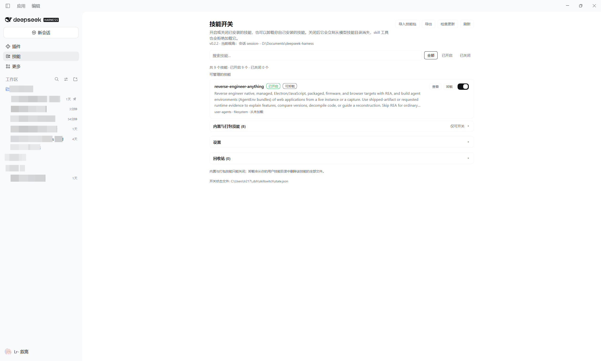
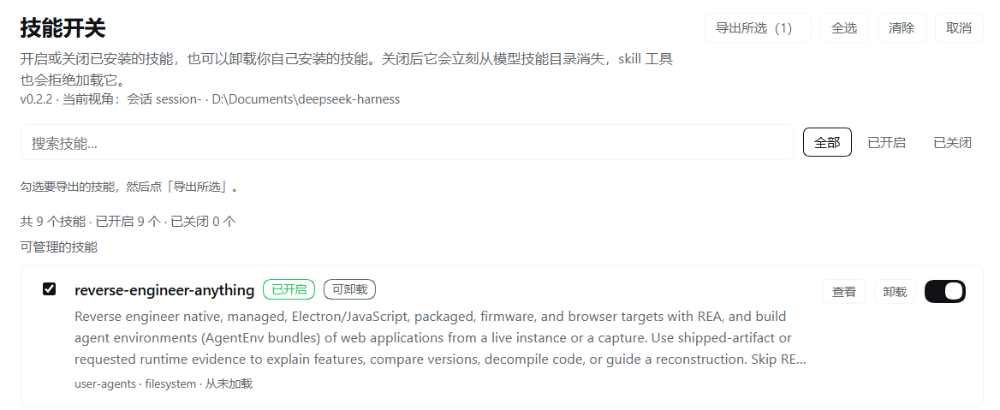
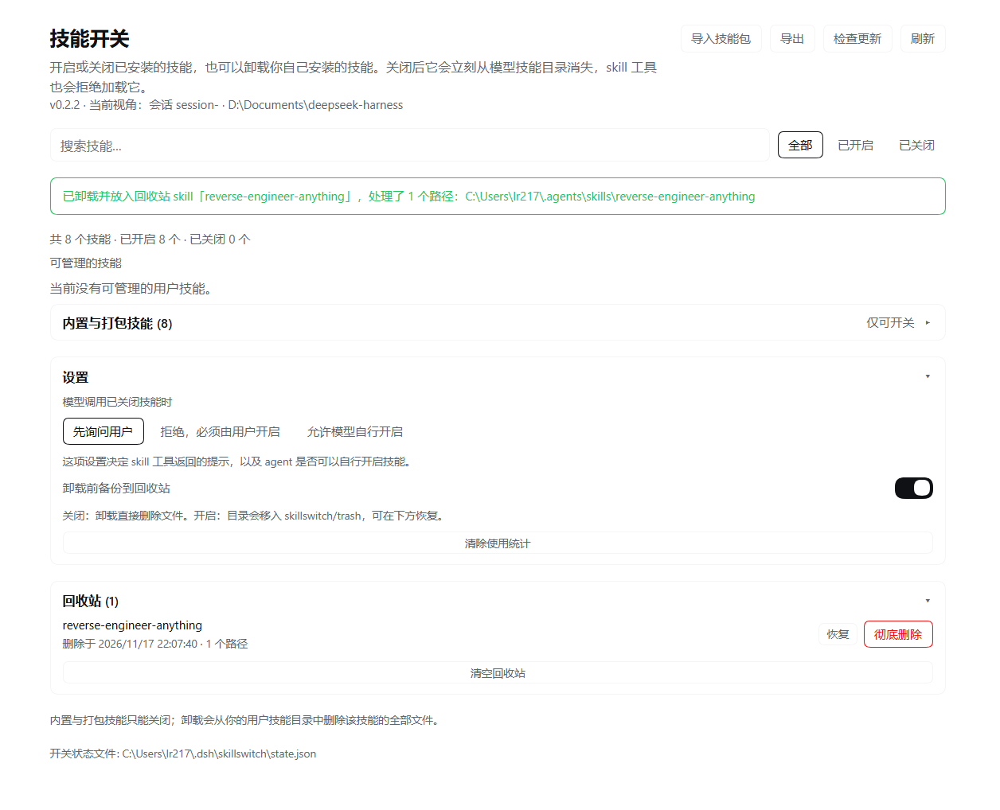
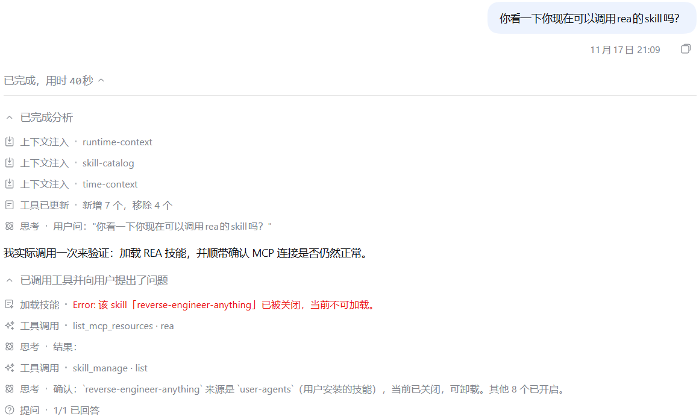

# dsh-skillswitch

[](https://www.npmjs.com/package/dsh-skillswitch)
[](LICENSE)

English | [中文](README.zh.md)



A DeepSeek Harness (DSH) plugin that adds a **Skills** page to the left sidebar of the Web
client and gives every installed skill one shared on/off switch.

## What it does

- **Lists every skill** the current session can see: name, source (`user-agents`,
  `bundled`, packaged provider, …), description, and whether it can be uninstalled.
- **Turns a skill on or off.** A disabled skill is served by a shadow skill provider
  whose invocation flags are both false, so it disappears from the session skill
  catalog at the next model request, the `skill` tool refuses to load it, and `/name`
  gestures no longer inject it. The skill's own files are left untouched.
- **Answers a stale call.** When the model calls `skill` for a disabled skill, a
  `tools/pre-execute` gate answers with the local “该 skill 已被关闭 …” reason. The
  message tells the model to ask the user first and then call
  `skill_manage(action="enable")`; the page reflects the same state immediately.
- **Uninstalls user-installed skills.** Only skill folders under writable roots
  (`$DSH_HOME/skills`, `$DSH_AGENTS_HOME/skills`, `<project>/.dsh/skills`,
  `<project>/.agents/skills`) are deleted — the whole bundle directory or the flat
  `.md` file, plus any same-name entry in those roots. Shipped and packaged skills
  cannot be deleted from the application; they can only be turned off.
- **Groups shipped skills.** Your own skills stay at the top; shipped and packaged
  skills live in a collapsible section that is folded by default.
- **Checks for updates from the page.** A *Check for updates* button compares the
  running version with the published npm version and links to the Plugins page when
  a newer one exists.
- **Searches and filters.** Filter by name/description/source, and by switched-on or
  switched-off state.
- **Previews skill bodies.** *View* shows the instruction file without loading the
  skill into the session; usage counters show how often each skill was loaded
  (*never loaded* marks unused ones).
- **Optional trash.** With *Back up uninstalled skills* enabled, uninstall moves the
  skill folder to `skillswitch/trash` where it can be restored or deleted for good.
- **Policy for disabled skills.** Settings choose what the `skill` tool answers when a
  disabled skill is called. *Require your approval* makes the agent's enable attempt show
  an approval prompt (the call runs only if you allow it once); *refuse* blocks model
  enable entirely; *allow* lets the agent enable it by itself. When the session disables
  approval prompts (`approval policy = never`), *require your approval* cannot show a
  prompt, so the model receives an explicit refusal asking the user to enable the skill
  from the page or switch the policy to *allow*.
- **Approval and skill switching.** DSH bundles the sandbox mode and the approval policy
  into permission presets: `workspace-write` pairs with `ask` (approval prompts appear),
  while `danger-full-access` pairs with `never` (approval prompts are off, so actions that
  require approval are rejected automatically). Switch presets from the composer with
  `/permission`. To keep full disk access and still get the approval prompt, add a custom
  preset to `@deepseek-ai/dsh-permission-presets` (`sandbox: danger-full-access`,
  `approval: ask`), or set this plugin's policy to *allow*.
- **Multi-select export and import.** The header *Export* button switches the list into
  selection mode: every exportable skill gets a checkbox (select all / clear / cancel),
  and *Export selected* downloads one JSON pack for all of them
  (`skillswitch-pack-N.skillpack.json`, files base64-encoded). *Import skill pack* adds
  one or many skills under `$DSH_HOME/skills` and never overwrites an existing skill.
- **Shows the session view.** The header states which session and working directory
  the list is read from, or that the global view is shown.

## Screenshots

| Multi-select export | Settings and trash |
|---|---|
|  |  |

## Why another skill plugin

Most skill managers only hide a skill from the picker. This one changes what the
**model** sees:

- The shadow provider is registered once in the global registry layer **and once in
  every live agent scope**, so it also wins against packaged or preset-scoped
  providers. Disabling a built-in skill such as `office` really removes it from the
  model catalog.
- The switch state is shared by the page and the model: the agent can ask you to turn
  a skill back on, and the page shows the result of that decision.

## A disabled skill stays disabled

When the agent tries to load a skill that is switched off, the `skill` tool answers with the
local "该 skill 已被关闭 …" error instead of quietly loading it. With the default *Require your
approval* policy, the agent's attempt to enable it waits for your approval as well.



## Install

Requires DSH **>= 0.2.2-rc.3**. Published on npm as
[`dsh-skillswitch`](https://www.npmjs.com/package/dsh-skillswitch).

1. **From npm (recommended)** — ask the agent to run:

   ```
   plugin_manager install_bundle target="dsh-skillswitch"
   ```

   Installed this way, the Plugins page can check for and apply updates.

2. **From GitHub** — ask the agent to run:

   ```
   plugin_manager install_bundle target=https://github.com/Lrht-llw/dsh-skillswitch.git
   ```

3. **From a local checkout** — open **Plugins** in the left sidebar, choose **Add plugin**,
   and point it at this directory; or run:

   ```
   plugin_manager install_bundle target=<absolute path to this directory>
   ```

A page entry named **Skills** appears in the left sidebar between Plugins and
Automation tasks. If the page does not appear right away, refresh the Web client.

## Use it

- **Page**: toggle a skill on or off with the switch on its row; press Uninstall twice
  to confirm deletion. Shipped skills show “shipped — disable only”.
- **Model tool**: `skill_manage` with `action: "list" | "enable" | "disable" | "uninstall"`
  and the exact skill name.

Switch state lives in `$DSH_HOME/skillswitch/state.json`. Removing the plugin does not
delete that file; delete the folder when you no longer need the saved switches.

## How it works

| Piece | Mechanism |
|---|---|
| Hide a skill | A shadow `SkillProvider` (rank `-1`, both invocation flags false) registered in the global layer and in each agent scope |
| Block a call | `tools/pre-execute` denial with the localized “disabled” reason |
| Page data | An authenticated exact Fetch route on `/api/skillswitch`, owner-only through the DSH connection fence |
| Agent operations | `skill_manage` tool sharing the same Host implementation as the page |
| Persistence | JSON state file under `$DSH_HOME/skillswitch` |

## Limitations

- The switch is profile-wide and takes effect from the next model request in every
  session. Content a session already loaded stays in that session's history; the
  engine appends a replacement catalog that retires the old list.
- Shipped and packaged skills cannot be uninstalled through the plugin (their files
  live inside the application), only switched off.
- Uninstalling a user skill deletes files and cannot be undone.

## License

Apache-2.0. See [LICENSE](LICENSE).
