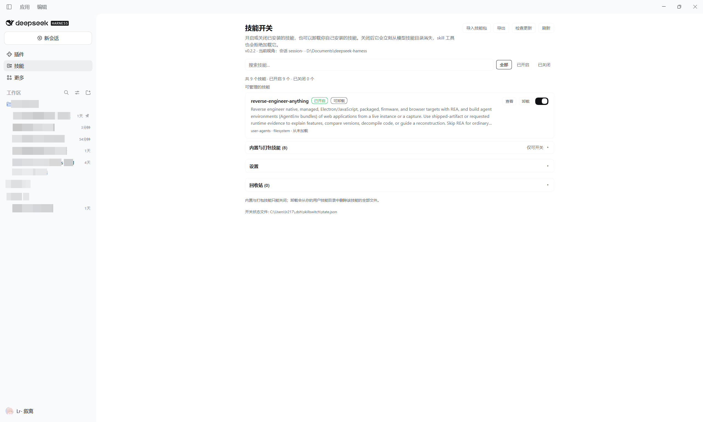
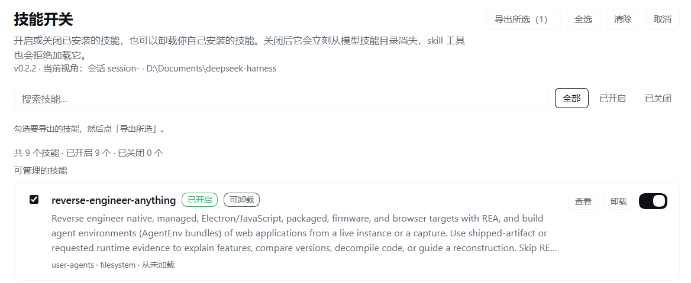
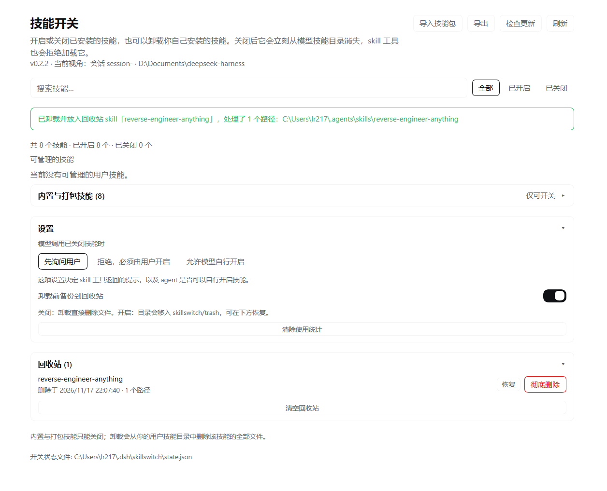

# dsh-skillswitch

[](https://www.npmjs.com/package/dsh-skillswitch)
[](LICENSE)

[English](README.md) | 中文



DeepSeek Harness（DSH）插件：在 Web 客户端左侧边栏新增 **「技能开关」** 页面，给每个已安装技能一个共享的开关。

## 功能

- **列出当前会话能看到的全部技能**：名称、来源（`user-agents`、`bundled`、打包 provider 等）、简介，以及是否可卸载。
- **开启 / 关闭技能**。关闭时由一个 invocation 全为 false 的影子 skill provider 接管该名字，于是它在下一次模型请求时从会话技能目录消失，`skill` 工具拒绝加载，`/name` 手势也不再注入。技能自身文件不会被改动。
- **拦住过时的调用**。模型对已关闭技能调用 `skill` 时，`tools/pre-execute` 闸门返回本地的「该 skill 已被关闭……」理由，并提示模型先征询用户、用户同意后再调用 `skill_manage(action="enable")`；页面会立刻显示同一状态。
- **卸载你自己安装的技能**。只删除可写根下的技能目录（`$DSH_HOME/skills`、`$DSH_AGENTS_HOME/skills`、`<项目>/.dsh/skills`、`<项目>/.agents/skills`）——整个技能目录或平铺的 `.md` 文件，连同这些根中的同名条目。内置与打包技能文件在应用内，只能关闭，不能卸载。
- **内置技能折叠分组**。你自己的技能排在前面；内置与打包技能收进一个默认折叠的分组里。
- **页面内检查更新**。「检查更新」按钮会把当前运行版本和 npm 上已发布的版本比较，发现新版本时给出前往插件页更新的入口。
- **搜索与筛选**。可按名称/描述/来源搜索，并按「已开启 / 已关闭」筛选。
- **技能正文预览**。「查看」直接展示技能指令文件，不把技能加载进会话；每个技能还显示被加载的次数，从未加载过的会标记出来。
- **可选回收站**。打开「卸载前备份到回收站」后，卸载会把技能目录移入 `skillswitch/trash`，可在页面恢复或彻底删除。
- **关闭策略**。设置里可选关闭技能被调用时的响应方式：先询问用户、拒绝并让用户开启、允许模型自行开启。
- **多选导出与导入**。页面顶部「导出」按钮会进入多选模式：每个可导出技能带复选框，可全选/清除/取消；点「导出所选」把选中技能打包成一个 JSON 技能包下载（`skillswitch-pack-N.skillpack.json`，文件 base64 编码）。「导入技能包」支持单个或多个技能，装到 `$DSH_HOME/skills`，不会覆盖已有同名技能。
- **会话视角提示**。页面顶部显示当前列表来自哪个会话与工作目录，或当前是全局视角。

## 界面截图

| 多选导出 | 设置与回收站 |
|---|---|
|  |  |

## 和常见技能管理插件有什么不同

多数同类插件只是把人眼可见的条目藏起来；本插件改的是**模型**能看到的东西：

- 影子 provider 同时注册在全局注册表层**和每个活跃 agent 的作用域层**，因此也能压过打包或 preset 作用域的 provider。关闭 `office` 这类内置技能时，它真的会从模型技能目录里消失。
- 开关状态由页面与模型共享：agent 可以征求你同意后重新开启，页面立刻反映结果。

## 安装

要求 DSH **>= 0.2.2-rc.3**。已发布到 npm：[`dsh-skillswitch`](https://www.npmjs.com/package/dsh-skillswitch)。

1. **从 npm 安装（推荐）**——让 agent 执行：

   ```
   plugin_manager install_bundle target="dsh-skillswitch"
   ```

   这样安装后，插件页可以直接检查更新并一键升级。

2. **从 GitHub 安装**——让 agent 执行：

   ```
   plugin_manager install_bundle target=https://github.com/Lrht-llw/dsh-skillswitch.git
   ```

3. **从本地目录安装**——左侧打开 **插件** → **添加插件**，选择本目录；或让 agent 执行：

   ```
   plugin_manager install_bundle target=<本目录绝对路径>
   ```

安装后左侧边栏会出现 **「技能」** 入口（位于「插件」与「自动化任务」之间）。若页面没有立即出现，刷新一次 Web 客户端。

## 使用

- **页面**：每行的开关直接启停；卸载需要连点两次确认。内置技能显示「内置/打包，仅可关闭」。
- **模型工具**：`skill_manage`，`action` 取 `list` / `enable` / `disable` / `uninstall`，并给出精确技能名。

开关状态保存在 `$DSH_HOME/skillswitch/state.json`。卸载插件不会删除该文件，不再需要时手动删掉目录即可。

## 实现要点

| 环节 | 机制 |
|---|---|
| 隐藏技能 | 注册 rank 为 `-1`、两个 invocation 均为 false 的影子 `SkillProvider`，同时挂在全局层与每个 agent 作用域层 |
| 拦截调用 | `tools/pre-execute` 返回本地化的「已被关闭」理由 |
| 页面数据 | `/api/skillswitch` 上的精确 Fetch 路由，经 DSH connection 鉴权，仅 owner 可达 |
| 模型操作 | `skill_manage` 工具与页面共用同一份 Host 实现 |
| 持久化 | `$DSH_HOME/skillswitch` 下的 JSON 状态文件 |

## 限制

- 开关是 profile 级的，对每个会话在下一次模型请求起生效。已经加载进某会话历史的内容不会消失，引擎会追加一份替换目录来退休旧列表。
- 内置与打包技能无法通过插件卸载（文件在应用安装包内），只能关闭。
- 卸载用户技能会删除文件，无法撤销。

## 许可

Apache-2.0，见 [LICENSE](LICENSE)。
